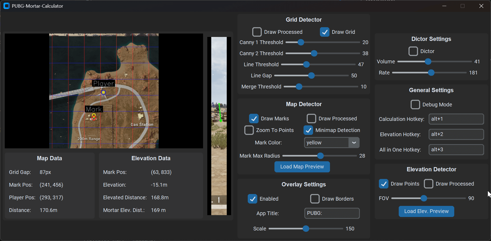
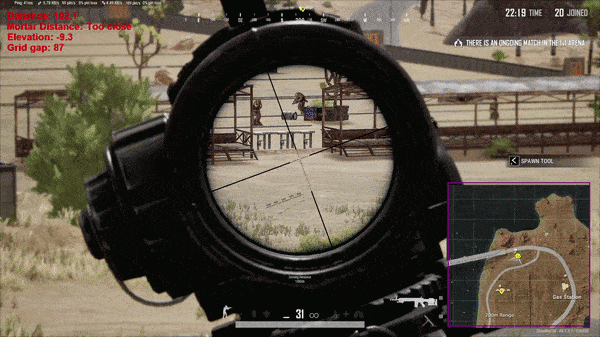

# PUBG Mortar Calculator

A tool to calculate the range of a shot for mortar in PUBG.

## Features

- [X] Calculation of planar distance between marks using map
- [X] Calculation of planar distance between marks using mini-map
- [X] Calculation of elevation realative to mark
- [X] GUI
- [X] Overlay
- [X] Dictor
- [ ] Calculating the distance of an airdrop 
- [ ] Contineous realtime calculation

## Preview

### GUI Preview (v4.5.3)


### Ingame Minimap Preview


## Installation

1. **Clone the repository:**
```bash
git clone https://github.com/IZomBiee/PUBG-Mortar-Calculator.git
cd PUBG-Mortar-Calculator
```

2. **Install minimap detection model (Optional but recommended):**
   - Go to the project repository's **Releases** tab and find the latest release labeled `minimap classification model`.
   - Download `map_model.onnx` and place it into the `assets/` folder.

3. **Install mark detection model (Optional but recommended):**
   - Go to the project repository's **Releases** tab and find the latest release that have `YOLO` in it.
   - Download `mark_model.onnx` and place it into the `assets/` folder.

4. **Run with uv:**
```bash
uv sync
uv run pubg_mortar_calculator
```

## Usage

Training mode is recommended for initial setup. While some settings may require tuning, it should generally work out of the box.

1. **Set up hotkeys** for calculations.
2. **Enable all visualizations**.
3. **Select your color** in the **Mark** tab and adjust FOV in the **Elevation** tab.
4. **Deploy a mortar**.
5. **Place your marker** in a location visible on the minimap.
6. **Mount the mortar**.
7. **Press the "All in One" hotkey**.
8. **Verify calculation output**: The program should provide planar distance and elevation. If detection fails:
   - Grid detection may be incorrect (enable visualization and adjust grid settings).
   - The marker was not detected (increase **Max Radius** or decrease **Min Radius**).
9. **Fine-tune as needed**: Adjust overlay/audio readout and fine-tune detection thresholds. In combat, simply place your marker and trigger the hotkey.

---

## Technical Notes

### Marker Detection System
- **HSV Detection**: Uses a basic algorithm that detects the circle with the largest radius in a given range. Because of this simplicity, false positives may occasionally occur.
- **YOLO Detection**: Significantly more accurate and reliable than HSV. While still being refined, it is the preferred mode. Uses a YOLO ONNX model under the hood and relies on HSV detection for initial Region of Interest (ROI) filtering.
- *Note: Both detection methods degrade inside the zone / red zone.*

### Display & Window Settings
- **Display Compatibility**: Incompatible with HDR, colorblind modes, or custom GPU driver color enhancements/vibrance tweaks.
- **Window Mode**: Not designed for exclusive Fullscreen mode. In Fullscreen, overlays will fail, and stretched aspect ratios will break grid detection. Use Borderless or Windowed mode.

### Debugging & Feedback
- **Debug Mode**: When enabled, all calculation logs and captured frames are saved to `last.log`. These can be reloaded into the program to diagnose detection or calculation failures.
- **Feedback**: Bug reports and feature suggestions are welcome - please submit an issue with logs attached.